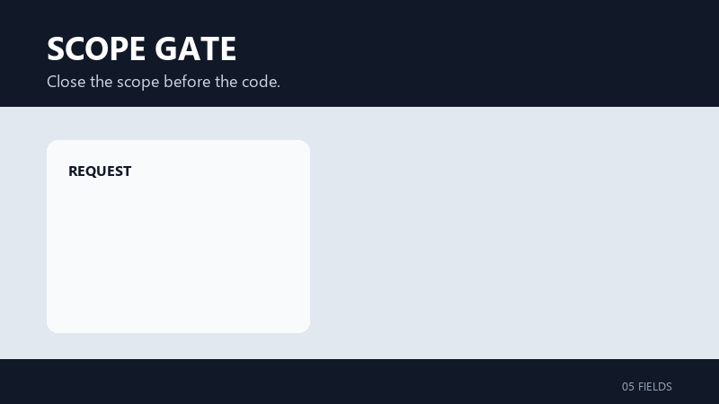

# Scope Gate

**Close the scope before the code.**

[简体中文](README.zh-CN.md)

Scope Gate is a single-purpose, platform-neutral Agent Skill that turns a delivery request into a closed five-field scope card before implementation starts. It fixes the goal, inputs and outputs, required work, exclusions, and acceptance conditions in `SCOPE.md`, then stops at the design handoff.



[](LICENSE)
[](https://agentskills.io/)
[](skills/scope-gate/SKILL.md)

## Why Scope Gate

Requirements often expand between the first prompt and the first commit. The model starts designing, splitting tickets, or writing code before the delivery boundary is settled. Scope Gate creates one compact checkpoint:

```text
request -> five-field scope -> SCOPE.md -> design and delivery
```

The value is not another document. It is a closed baseline that later work can be checked against.

- Five fixed fields keep the scope review short.
- Explicit exclusions expose adjacent work before it enters the delivery.
- Observable acceptance conditions prevent "done" from becoming subjective.
- A versioned `SCOPE.md` preserves the agreed baseline in the workspace.
- A hard stop keeps ADRs, tickets, estimates, and implementation out of scope review.

Scope Gate is intentionally single-purpose and portable across Agent hosts. It does not replace requirements engineering, architecture review, or project management.

## Quick Start

Scope Gate uses the portable Agent Skill layout. Run each command in the target project root; it copies `skills/scope-gate` into that host's project-level skill directory. The trailing `-y` installs without prompts and keeps that project-level default. Replace `--copy` with `--global --copy` to target the host's user-level directory; some hosts also require user-level discovery to be enabled. If the host is already running when you install, restart or reload the session afterwards: a running host may still cache the old skill catalog. The commands require Node.js and npm.

<details>
<summary><strong>Codex</strong></summary>

```bash
npx --yes skills@latest add OmegaLab2026/scope-gate --skill scope-gate --agent codex --copy -y
```

Enter `$scope-gate`. [Documentation](https://developers.openai.com/codex/skills/)

</details>

<details>
<summary><strong>Claude Code</strong></summary>

```bash
npx --yes skills@latest add OmegaLab2026/scope-gate --skill scope-gate --agent claude-code --copy -y
```

Enter `/scope-gate`. [Documentation](https://code.claude.com/docs/en/skills)

</details>

<details>
<summary><strong>DeepSeek Harness (DSH)</strong></summary>

```bash
npx --yes skills@latest add OmegaLab2026/scope-gate --skill scope-gate --agent pi --copy -y
```

The Pi-compatible target writes the shared `.agents/skills` root that DSH scans. After installing, open a new session or refresh the DSH window before `scope-gate` appears in `/`: DSH prefetches and caches the skill catalog per session, so an external install does not invalidate it automatically. You can also ask the Agent to use `scope-gate` through DSH's `skill` tool. [Documentation](https://github.com/deepseek-ai/deepseek-harness/blob/master/docs/subsystems/skills.md)

</details>

<details>
<summary><strong>Cursor</strong></summary>

```bash
npx --yes skills@latest add OmegaLab2026/scope-gate --skill scope-gate --agent cursor --copy -y
```

Type `/` in Agent chat and select `scope-gate`. [Documentation](https://cursor.com/docs/context/skills)

</details>

<details>
<summary><strong>Gemini CLI</strong></summary>

```bash
npx --yes skills@latest add OmegaLab2026/scope-gate --skill scope-gate --agent gemini-cli --copy -y
```

Ask the Agent to use the `scope-gate` skill, then confirm discovery with `/skills list`. [Documentation](https://github.com/google-gemini/gemini-cli/blob/main/docs/cli/skills.md)

</details>

<details>
<summary><strong>Pi</strong></summary>

```bash
npx --yes skills@latest add OmegaLab2026/scope-gate --skill scope-gate --agent pi --copy -y
```

Enter `/skill:scope-gate`. Use `/reload` after editing the skill. [Documentation](https://pi.dev/docs/latest/skills)

</details>

<details>
<summary><strong>Oh My Pi</strong></summary>

```bash
npx --yes skills@latest add OmegaLab2026/scope-gate --skill scope-gate --agent pi --copy -y
```

The Pi-compatible target writes the shared `.agents/skills` layout that Oh My Pi loads. Enter `/skill:scope-gate`; enable `skills.enableSkillCommands` if the slash command is unavailable. [Documentation](https://github.com/can1357/oh-my-pi/blob/main/docs/skills.md)

</details>

<details>
<summary><strong>OpenCode</strong></summary>

```bash
npx --yes skills@latest add OmegaLab2026/scope-gate --skill scope-gate --agent opencode --copy -y
```

Ask the Agent to use the `scope-gate` skill. [Documentation](https://opencode.ai/docs/skills/)

</details>

<details>
<summary><strong>WorkBuddy (manual packaging required)</strong></summary>

Package this `SKILL.md` into WorkBuddy's `skill.yml` format and publish it to Skill Marketplace before installing it there. [Marketplace](https://www.workbuddy.ai/docs/workbuddy/From-Beginner-to-Expert-Guide/Function-Description/Skills-Market) · [Skill format](https://www.workbuddy.ai/docs/workbuddy/From-Beginner-to-Expert-Guide/Practice-Cases/Create-Skills)

</details>

<details>
<summary><strong>Qoder</strong></summary>

```bash
npx --yes skills@latest add OmegaLab2026/scope-gate --skill scope-gate --agent qoder --copy -y
```

Enter `/scope-gate`; use `/skills reload` if Qoder is already running. [Documentation](https://docs.qoder.com/cli/Skills)

</details>

<details>
<summary><strong>Trae</strong></summary>

```bash
npx --yes skills@latest add OmegaLab2026/scope-gate --skill scope-gate --agent trae --copy -y
```

Ask the Agent to use the `scope-gate` skill. [Documentation](https://docs.trae.ai/ide/skills)

</details>

The `--agent pi` install writes the portable project-level `.agents/skills/scope-gate` folder, which Codex, Cursor, Gemini CLI, Pi, Oh My Pi, OpenCode, and DeepSeek Harness (DSH) discover. Hosts that support implicit invocation may also select the skill when a request clearly needs delivery scope clarification.

## Example

Input:

```text
Add CSV import validation to the admin app so malformed customer files
are rejected before data is written.
```

Scope Gate produces the five-field card and writes it to `SCOPE.md`. See the complete [example scope](examples/SCOPE.md).

```markdown
## Goal

Reject malformed customer CSV files before any row is persisted.

## Inputs / Outputs

- Input: a customer CSV file and the documented import schema.
- Output: a validation result that identifies rejected rows and prevents partial writes.

## Must do

- Validate the file against the documented schema before persistence.

## Won't do

- Redesigning the import interface.

## Acceptance

- A malformed fixture produces a failed validation result and persists zero rows.
```

## Guardrails

| Field | Required content |
| --- | --- |
| `Goal` | One observable delivery outcome and its boundary |
| `Inputs / Outputs` | Available or required inputs and finished deliverables |
| `Must do` | The minimum required obligations |
| `Won't do` | Adjacent work explicitly excluded |
| `Acceptance` | Reproducible pass conditions for every required item |

The skill stops before ADRs, technical designs, ticket breakdowns, estimates, schedules, and implementation. If a user asks for one of those, that is a separate task.

Scope-changing questions use a fixed protocol: brief impact analysis, two to four mutually exclusive options, and one recommendation.

## Compatibility and Validation

Scope Gate uses the portable Agent Skill layout:

```text
skills/scope-gate/
|-- SKILL.md
`-- agents/
    `-- openai.yaml
```

`agents/openai.yaml` only provides optional UI metadata for OpenAI hosts; other hosts need only `SKILL.md`.

Repository checks:

```powershell
python tests/validate_scope.py
python -m unittest discover -s tests -v
```

The structural checks cover frontmatter, the frozen five-heading contract, metadata, example scope, routing fixtures, metadata file, and README assets. The package is also checked with OpenAI's `skill-creator` validation script. These checks do not prove model behavior in every runtime; live agent evaluation remains separate.

## Contributing

Keep changes aligned with the single purpose: close delivery scope, then stop.

A contribution should:

1. Preserve the five headings and their order.
2. Preserve the question protocol and versioning rules.
3. Add or update routing fixtures when invocation behavior changes.
4. Run both validation commands above.
5. Explain any change that strengthens or relaxes the stop boundary.

Feature expansion into ADRs, planning, estimates, or implementation is outside this project's scope.

## License

[MIT](LICENSE)
